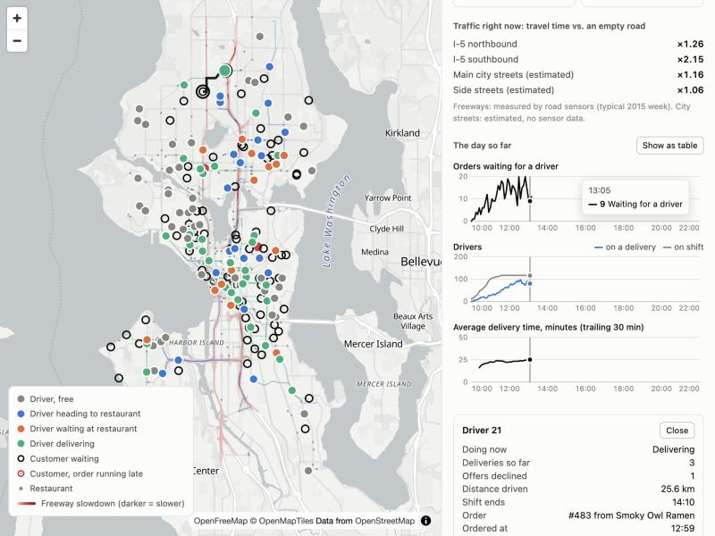

# Seattle Dispatch Lab

A food-delivery dispatcher you can watch and tinker with. Simulated drivers,
customers and restaurants run on Seattle's real street network, slowed down by
real freeway traffic patterns, while a dispatcher decides which driver gets
which order.

It is a learning project for understanding how dispatch systems work. It is not
affiliated with any delivery company and uses no company's data.



## Quick start

Needs [uv](https://docs.astral.sh/uv/) and Python 3.12+.

```bash
uv run dispatch-lab setup      # once: downloads Seattle's streets from OpenStreetMap (~4 min)
uv run dispatch-lab serve      # then open http://127.0.0.1:8765
uv run dispatch-lab compare    # run all three dispatchers on the same day, print a table
uv run pytest                  # tests use a small made-up grid; no download needed
```

In the live view you can pause, change speed (up to 300 simulated seconds per
second), switch dispatcher mid-day, click a driver to follow them, and restart
the day with more drivers, more orders, a different weekday, or more traffic.

## The three dispatchers

All three live in [`dispatch.py`](src/seattle_dispatch_lab/dispatch.py) and are
short enough to read in one sitting.

| Name | What it does |
|---|---|
| `nearest` | Each order, oldest first, immediately takes the closest free driver. |
| `matching` | Every 30 seconds, looks at all open orders and free drivers together and picks the set of pairs with the lowest total cost. |
| `matching_jit` | Same, but holds an order back until a driver sent now would arrive about when the food is ready. |

One simulated Friday, 10:00 to 22:00, same orders and drivers for each
(`uv run dispatch-lab compare`, seed 7):

| | nearest | matching | matching_jit |
|---|---:|---:|---:|
| Average delivery time (min) | 28.8 | 25.4 | 26.2 |
| Late vs. promised time (%) | 22.5 | 5.9 | 6.7 |
| Drive to restaurant (min) | 9.4 | 7.0 | 7.4 |
| Driver waits at restaurant (min) | 5.2 | 6.5 | 3.8 |
| Driver time spent on deliveries (%) | 67.8 | 64.2 | 59.0 |

With 30% more orders (`--peak-orders-per-hour 520`) the greedy dispatcher falls
apart: 50% of orders late and a 44-minute average, against 12% and 28 minutes
for matching.

Two things worth noticing:

- **Matching beats greedy by looking at everyone at once.** Greedy hands the
  closest driver to whichever order asked first, even when a later order needed
  that driver far more.
- **Just-in-time is a trade, not a free win.** It cuts the time drivers stand
  around at restaurants and frees up driver time, but deliveries get slightly
  slower, because a late decision leaves less room for a declined offer or a
  wrong estimate.

## How the simulation works

- **Events, not frames.** Everything that will happen at a known time (an order
  is placed, a driver arrives, the dispatcher wakes up) sits in a priority
  queue. Driver positions between events are interpolated along their route.
  Twelve simulated hours run in about 7 seconds.
- **The dispatcher only gets estimates.** It sees expected food-ready times and
  estimated drive times. The simulator separately decides the truth: how long
  the kitchen really took, the real route under current traffic, and whether a
  driver declines the offer (more likely for long pickups).
- **Same world for every dispatcher.** For a given seed the orders, kitchens and
  driver shifts are identical, so differences in the results come from the
  dispatcher.

## What is real and what is made up

| | Source |
|---|---|
| Streets and speed limits | Real. OpenStreetMap, Seattle city limits. |
| Freeway traffic (I-5, I-90, SR-520) | Real. Typical week from 2015 road-sensor data, by direction, in 15-minute steps. |
| Traffic on other freeways (SR-99 etc.) | Assumed: the average of the measured freeways. |
| Traffic on city streets | Assumed: a damped copy of the freeway pattern. No public sensor data covers them. |
| Speeds on an empty city street | Assumed: 62% of the limit on main streets, 50% on side streets, to account for signals and turns. |
| Restaurant locations | Real food-venue locations from OpenStreetMap. Names, menus, prep times and popularity are made up. |
| Customers | Made up. Placed on residential streets within 4.5 km of the restaurant. |
| Orders, drivers, shifts, declines | Made up. Lunch and dinner peaks, a few busy restaurants, drivers who decline far pickups. |

Because so much of the demand side is invented, the absolute numbers mean
little. The comparisons between dispatchers on the same world are the useful
part.

## Layout

```
src/seattle_dispatch_lab/
  network.py    street network: build from OpenStreetMap, fast routing
  traffic.py    slowdown by road type and time of week
  sim.py        the simulated world and its event loop
  dispatch.py   the three dispatchers
  server.py     streams the running simulation to the browser
  web/          the live map (plain HTML and JavaScript, no build step)
  cli.py        setup / run / compare / serve
scripts/
  build_traffic_profile.py   turns the 274 MB sensor dataset into data/traffic_profile.json
  collect_wsdot.py           records live WSDOT travel times (not used by the simulator yet)
```

## Ideas to try next

- Let one driver carry two orders from nearby restaurants.
- Offer a driver their next order before they finish the current one.
- Replace the drive-time estimate with a model trained on the simulator's own
  history, and see how much dispatch improves.
- Move idle drivers toward where orders are about to appear.
- Use `collect_wsdot.py` snapshots to run on today's traffic.

## Data credits

- Street network and venue locations © [OpenStreetMap](https://www.openstreetmap.org/copyright)
  contributors (ODbL), fetched with [OSMnx](https://github.com/gboeing/osmnx).
  Downloaded by `setup`; not stored in this repository.
- Freeway speeds: *Freeway Inductive Loop Detector Dataset for Network-wide
  Traffic Speed Prediction*, UW STAR Lab with data from WSDOT,
  [zenodo.org/records/3258904](https://zenodo.org/records/3258904), CC-BY-4.0.
  `data/traffic_profile.json` is derived from it.
- Map tiles in the live view: [OpenFreeMap](https://openfreemap.org).

## License

Code: [MIT](LICENSE). `data/traffic_profile.json` is derived from the CC-BY-4.0
dataset credited above and stays under that license.
